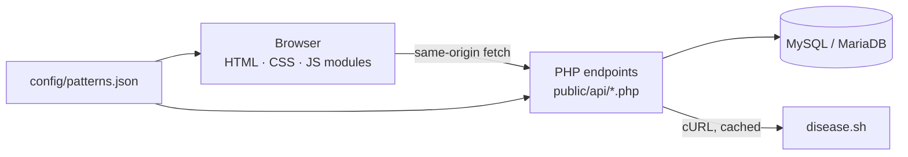

<div align="center">

# Covid-flow

### Dynamic COVID-19 Information Portal - Software Testing & Quality Assurance

A responsive, accessible COVID-19 information website built with **HTML, CSS, JavaScript, PHP and MySQL**,
backed by a documented **regular-expression test suite** that runs identically in the browser, in Node.js and in PHP.


</div>

---

## Table of contents

1. [Overview](#1-overview)
2. [Features](#2-features)
3. [Tech stack](#3-tech-stack)
4. [Architecture](#4-architecture)
5. [Project structure](#5-project-structure)
6. [Getting started](#6-getting-started)
7. [Regular-expression validation](#7-regular-expression-validation)
8. [Testing](#8-testing)
9. [QA documentation](#9-qa-documentation)
10. [Security](#10-security)
11. [Known limitations](#11-known-limitations)
12. [Data attribution and disclaimer](#12-data-attribution-and-disclaimer)
13. [Author](#13-author)

---

## 1. Overview

> **Problem statement:** *"Software Testing and Quality Assurance Mini Project: Dynamic website of COVID-19 information using HTML, CSS, JavaScript and PHP. MySQL database used to store user account, comment, and registration form details. Regular expression test cases for testing purposes."*

The project delivers two things of equal weight:

| | Deliverable | What it contains |
|---|---|---|
| **1** | **The product** | A COVID-19 information site with live statistics, guidance pages, user accounts, a community comment board and a separate programme-registration form, all stored in MySQL/MariaDB. |
| **2** | **The quality evidence** | One shared set of validation patterns used by both JavaScript and PHP, a large table of valid/invalid test inputs, automated runners, an in-browser **Quality Lab**, and a full set of SQA documents (test plan, test cases, traceability matrix, defect log, test report). |

---

## 2. Features

Requirement IDs (`FR-xx`) are used throughout `docs/` for traceability.

| ID | Feature |
|---|---|
| **FR-01** | **Home dashboard** — global confirmed, active, recovered and death counts, daily changes, source and last-updated time. |
| **FR-02** | **Statistics** — historical trend chart (30D / 90D / 180D / 1Y / All) and a searchable, sortable country table. |
| **FR-03** | **Guidance pages** — Prevention, Symptoms, Vaccination, Myths vs Facts and Helplines, with WHO / MoHFW citations. |
| **FR-04** | **Sign up** — client- and server-side validation, hashed passwords, duplicate account rejection. |
| **FR-05** | **Login / logout** — hardened sessions, session-ID regeneration, brute-force lockout (5 attempts / 15 minutes). |
| **FR-06** | **Profile** — account details, own registrations (with cancel) and own comments. |
| **FR-07** | **Community board** — paginated comments, 500-character counter, regex sanitisation, delete own comment. |
| **FR-08** | **Programme registration** — separate enrolment form, MySQL persistence, duplicate prevention, reference numbers (`REG-XXXXXX`). |
| **FR-09** | **Shared regex validation** — nine fields validated identically in JavaScript and PHP. |
| **FR-10** | **Quality Lab** — live pattern tester, in-browser suite runner, CSV / JSON export and explainer cards. |
| **FR-11** | **Professional UI** — light / dark theme, responsive grids, keyboard accessibility, WCAG AA contrast. |
| **FR-12** | **Resilient data handling** — MySQL cache, stale-data banner on upstream failure, honest empty state (no invented numbers). |
| **FR-13** | **Admin moderation** *(stretch)* — view, filter, hide, restore and soft-delete comments. |

---

## 3. Tech stack

| Layer | Technology |
|---|---|
| Front end | HTML5, CSS3 (custom properties), vanilla JavaScript (ES modules) |
| Back end | PHP 8.1+ with PDO — no framework |
| Database | MySQL 8 / MariaDB (InnoDB, `utf8mb4`) |
| Charts | Chart.js (vendored, no CDN) |
| Data source | [disease.sh](https://disease.sh) — fetched server-side and cached |
| Containers | Docker Compose (`covid_web` + `covid_db`) |
| Testing | Node.js scripts, PHP CLI scripts, `curl` smoke tests |

---

## 4. Architecture



The browser never calls a third-party API. All statistics go through `api/stats.php`, which serves cached data when the upstream is unavailable.

### Key decisions

| ADR | Decision | Why |
|---|---|---|
| **001** | Plain PHP 8.1+ with PDO, no framework | Readable for grading; prepared statements with `ATTR_EMULATE_PREPARES => false`. |
| **002** | Server-side data fetch with MySQL cache (`covid_cache`) | Avoids CORS, leaks no visitor IPs to third parties, and survives upstream outages. |
| **003** | Native PHP sessions + CSRF tokens + login throttling | Simple, auditable, no third-party auth. |
| **004** | One regex source of truth (`config/patterns.json`) | JS and PHP regex engines differ in subtle ways; one file plus a parity test keeps them aligned. |
| **005** | Docker Compose for local execution | Reproducible on any machine without dependency drift. |

---

## 5. Project structure

```
Covid-flow/
├── public/                  # web root
│   ├── index.php            # Home
│   ├── statistics.php
│   ├── prevention.php · symptoms.php · vaccination.php · myths.php · helplines.php
│   ├── community.php
│   ├── program-registration.php
│   ├── signup.php · login.php · logout.php · profile.php
│   ├── quality-lab.php
│   ├── admin/comments.php
│   ├── api/                 # stats, comments, check-username, patterns, regex-cases
│   └── assets/              # css/, js/, img/, vendor/
├── includes/                # bootstrap, db, auth, csrf, validate, helpers, covid client, layout
├── config/                  # config.example.php, patterns.json
├── data/                    # content.json (guidance pages), optional fallback snapshot
├── database/                # schema.sql, create_admin.php
├── tests/                   # regex cases + Node/PHP runners, smoke tests
├── docs/                    # SQA documents
├── docker-compose.yml
├── .htaccess
└── README.md
```

---

## 6. Getting started

### Option A — Docker (recommended)

```bash
git clone https://github.com/Omsongire23/Covid-flow.git
cd Covid-flow
docker compose up -d
```

| Service | Details |
|---|---|
| Web | `http://127.0.0.1:8000` |
| Database | host `127.0.0.1`, port `3307`, database `covid_portal`, user `covid_user`, password `covid_pass` |

> The database credentials above are **local development defaults** for the Docker setup. Change them before exposing the stack to any network.

Create an administrator account (interactive; there is no default admin):

```bash
docker compose exec web php database/create_admin.php
```

### Option B — Native (Apache or built-in server)

**Prerequisites:** PHP 8.1+ with `pdo_mysql`, `curl` and `mbstring`; MySQL 8 or MariaDB; Node.js 18+ (for tests only).

Debian / Ubuntu example:

```bash
sudo apt update
sudo apt install -y php php-cli php-mysql php-curl php-mbstring mariadb-server
```

```bash
# 1. Create the schema
mysql -u root -p < database/schema.sql

# 2. Configure credentials
cp config/config.example.php config/config.local.php   # then edit DB settings

# 3. Run the development server
php -S 127.0.0.1:8000 -t public
```

Using XAMPP/WAMP: point a virtual host or alias at the `public/` directory and make sure the `curl` and `pdo_mysql` extensions are enabled in `php.ini`.

---

## 7. Regular-expression validation

All patterns live in [`config/patterns.json`](config/patterns.json). PHP loads the file for server-side validation, and `api/patterns.php` serves the same file to the browser, so the client and server cannot drift apart.

| Field | What it guarantees |
|---|---|
| `username` | 4–20 characters; starts with a letter; letters, digits and underscore only. |
| `fullName` | 2–60 letters (any language); single spaces, apostrophes or hyphens between words. |
| `email` | 6–254 characters; no consecutive, leading or trailing dots in the local part; TLD of at least two letters. |
| `password` | 8–64 characters with lowercase, uppercase, digits, and special characters; no whitespace. |
| `phoneIN` | 10-digit Indian mobile number starting with 6–9; optional `+91` or `0` prefix. |
| `dob` | `YYYY-MM-DD` format with months 01–12 and days 01–31. Calendar validity and age limits are checked separately in PHP. |
| `pinCode` | 6 digits; first digit 1–9. |
| `countryQuery` | 2–56 letters; spaces, dots, apostrophes and hyphens allowed; rejects injection and path strings. |
| `comment` | 3–500 characters; not blank; rejects HTML-tag-like content. |

<details>
<summary><strong>Show the raw patterns</strong></summary>

```text
username      ^[A-Za-z][A-Za-z0-9_]{3,19}$
fullName      ^(?=.{2,60}$)[\p{L}\p{M}]+(?:[ '\-][\p{L}\p{M}]+)*$
email         ^(?=.{6,254}$)(?!.*\.\.)[A-Za-z0-9](?:[A-Za-z0-9._%+\-]*[A-Za-z0-9])?@(?:[A-Za-z0-9](?:[A-Za-z0-9\-]{0,61}[A-Za-z0-9])?\.)+[A-Za-z]{2,24}$
password      ^(?=.*[a-z])(?=.*[A-Z])(?=.*\d)(?=.*[^A-Za-z0-9\s])\S{8,64}$
phoneIN       ^(?:\+91[\- ]?|0)?[6-9]\d{9}$
dob           ^\d{4}-(?:0[1-9]|1[0-2])-(?:0[1-9]|[12]\d|3[01])$
pinCode       ^[1-9]\d{5}$
countryQuery  ^[\p{L}\p{M}][\p{L}\p{M} .'\-]{1,55}$
comment       ^(?=[\s\S]{3,500}$)(?=[\s\S]*\S)(?![\s\S]*<[^>]*>)[\s\S]*$
```

In `patterns.json`, the backslashes are JSON-escaped (`\\d` instead of `\d`).

</details>

### Cross-engine rules

JavaScript and PHP (PCRE) interpret the same pattern slightly differently. These rules are mandatory, and each one is covered by tests.

1. **JavaScript:** compile with the `u` flag — `new RegExp(pattern, 'u')`.
2. **PHP:** compile with the `D` and `u` modifiers — `preg_match('~' . $pattern . '~Du', $value)` — and treat a `false` result as invalid.
   - **`D`** stops PCRE's `$` from matching *before a trailing newline*. Without it, `"abcd\n"` is accepted as a valid username.
   - **`u`** enables `\p{L}` / `\p{M}` and counts characters instead of bytes, so non-Latin names and comments are handled correctly.
3. **ReDoS-safe ordering:** the `comment` pattern checks length **first**, then blankness, then tags. The original ordering took several seconds on a 100,000-character hostile input; the final one takes under 2 ms.
4. **Shape vs. meaning:** regex checks the *shape* of input. Semantic rules (real calendar dates, age range, allow-lists for state/service/gender) are enforced in `includes/validate.php`.

---

## 8. Testing

Run everything:

```bash
bash tests/run-all.sh
```

| # | Suite | Command | Checks |
|---|---|---|---|
| 1 | JavaScript regex | `node tests/regex.test.mjs` | Every case in `tests/regex-cases.json` against the JS engine, plus timing on hostile inputs. |
| 2 | PHP regex | `docker compose exec web php tests/regex_test.php` | The same cases against PCRE with `~…~Du`. |
| 3 | Engine parity | `node tests/engine-parity.mjs` | Fails if the JS and PHP engines ever disagree on any case. |
| 4 | Semantic validator | `docker compose exec web php tests/validator_test.php` | Calendar dates, age range, phone normalisation, allow-lists. |
| 5 | HTTP smoke and security | `bash tests/smoke.sh` | Endpoint responses, CSRF, auth, headers, injection attempts. |

Without Docker, run the PHP suites directly: `php tests/regex_test.php`, `php tests/validator_test.php`.

### Quality Lab

Open **`/quality-lab.php`** for an interactive view of the testing work:

- **Live tester** — pick a field, type input and see an instant pass/fail.
- **Suite runner** — run all cases in the browser, filter by result or field, and export **CSV** or **JSON**.
- **Explainer cards** — the `D` modifier, ReDoS ordering and shape-vs-semantic validation, drawn from real findings.

---

## 9. QA documentation

All course deliverables are in [`docs/`](docs/):

| Document | Purpose |
|---|---|
| [`TEST_PLAN.md`](docs/TEST_PLAN.md) | Strategy, scope, entry/exit criteria and environment. |
| [`TEST_CASES.md`](docs/TEST_CASES.md) | Catalogue of system, security, API and regex test cases. |
| [`TRACEABILITY.md`](docs/TRACEABILITY.md) | Matrix linking FR-01 … FR-13 to test cases. |
| [`DEFECT_LOG.md`](docs/DEFECT_LOG.md) | Defects found, root causes and fixes. |
| [`TEST_REPORT.md`](docs/TEST_REPORT.md) | Execution results with command output. |

For current pass/fail counts, treat `docs/TEST_REPORT.md` as the source of truth.

---

## 10. Security

| Area | Measure |
|---|---|
| SQL injection | PDO prepared statements only, with native (non-emulated) preparation. |
| XSS | All dynamic output escaped with `e()` (`htmlspecialchars` with `ENT_QUOTES \| ENT_SUBSTITUTE`, UTF-8); comments are stored raw and escaped on output. |
| CSP | No inline scripts or styles. `default-src 'self'; img-src 'self' data:; script-src 'self'; style-src 'self'; object-src 'none'; base-uri 'none'; form-action 'self'; frame-ancestors 'none'` |
| CSRF | 32-byte random token per session on every state-changing request, compared with `hash_equals`. |
| Passwords | `password_hash()` / `password_verify()`; rehash on login when needed. |
| Brute force | 5 failed attempts per (username, IP) in 15 minutes returns HTTP 429. |
| User enumeration | One generic login error; a dummy hash is verified when the user does not exist. |
| Sessions | `HttpOnly`, `SameSite=Lax`, `Secure` over HTTPS, ID regeneration on login, 30-minute idle timeout. |
| Privacy | The browser makes no third-party requests; the registration form collects no medical history. |

---

## 11. Known limitations

- **Usernames are ASCII-only** by design.
- **The email pattern is stricter than RFC 5322:** no quoted local parts, IP-literal domains or internationalised domains.
- **The `dob` pattern checks shape only**; leap years and impossible dates (such as `2023-02-31`) are rejected by the PHP validator, not by regex.
- **The comment pattern rejects tag-like text**, so input such as `5 < 6 and 7 > 3` is a documented false positive.
- **Statistics depend on disease.sh.** Some series (for example, recovered counts) may be missing or frozen in the source; the UI labels this rather than filling gaps. When the source is unreachable, the site shows cached data with a banner or an empty state.
- **Not production-hardened:** the Docker setup uses development credentials and HTTP. Use HTTPS and strong secrets before any public deployment.

---

## 12. Data attribution and disclaimer

- **Statistics:** retrieved from the open [disease.sh](https://disease.sh) API.
- **Guidance:** cited from the World Health Organization (WHO) and the Ministry of Health and Family Welfare (MoHFW), Government of India.

> **Medical disclaimer:** This website was built for academic Software Testing and Quality Assurance purposes. It does not replace professional medical advice, diagnosis or treatment. In an emergency, contact your local emergency services or the national helpline **1075**.

---

## 13. Author

**Om** — [@Omsongire23](https://github.com/Omsongire23)

If you reuse this project, please keep the data attribution and the medical disclaimer.
