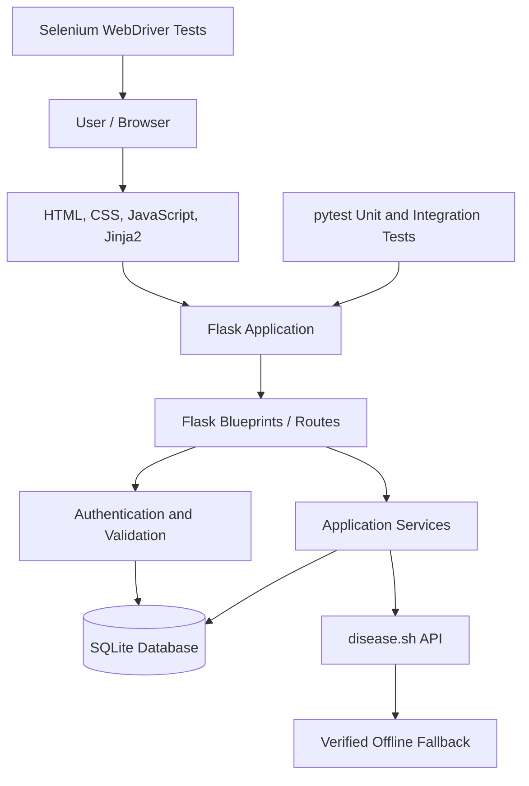
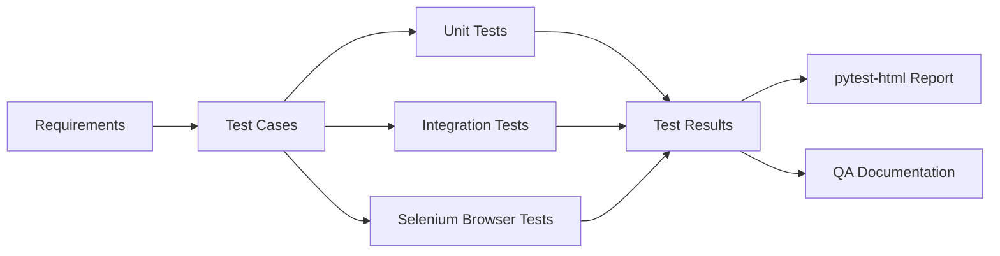

COVID-FLOW — COVID-19 Health Intelligence & Testing Portal
Software Testing and Quality Assurance (STQA) Mini Project
A responsive COVID-19 health information and surveillance portal built with Python 3.13, Flask, SQLite, HTML5, CSS3 and JavaScript. The project demonstrates practical STQA techniques including centralized input validation, Equivalence Partitioning (EP), Boundary Value Analysis (BVA), unit and integration testing, and Selenium 4 browser automation using the Page Object Model (POM).

Table of contents
1. Project overview
2. Key features
3. Technology stack
4. Application architecture
5. Project structure
6. Quick start
7. Validation and STQA techniques
8. Running the automated tests
9. Selenium browser automation
10. QA documentation and reports
11. Security and reliability
12. Known limitations
13. License and disclaimer
14. Author
1. Project overview
COVID-FLOW is a public health surveillance and information portal developed as a Software Testing and Quality Assurance mini project. It combines a user-facing COVID-19 information website with a structured testing environment used to demonstrate software quality practices.

The project has two connected deliverables:
Deliverable	Description
COVID-19 information portal	Dashboard, global statistics, health guidance, symptoms assessment, vaccination information, community discussion, user accounts and programme registration.
STQA testing framework	Centralized validation, equivalence classes, boundary-value test cases, unit and integration tests, Selenium browser automation, test reports and examination-oriented documentation.

The application can retrieve COVID-19 statistics from disease.sh and use a verified offline fallback when live data is unavailable. The interface should clearly communicate the source and synchronization status of displayed data.
2. Key features
1. Live dashboard and global surveillance — displays global confirmed cases, active cases, recoveries and deaths using disease.sh data or a verified offline fallback.
2. Interactive statistics and trajectories — provides a 30-day epidemiological trend chart using Chart.js and a searchable country-wise metrics table.
3. Public health guidance — includes prevention protocols, a symptoms assessment page with emergency warning indicators, vaccination facts, myth-versus-fact information, and a national/regional helpline directory.
4. User authentication and profile — supports account registration, secure password hashing with werkzeug.security, session handling, login throttling and a profile showing the user's comment history and registrations.
5. Community discussion — provides authenticated comment submission, a 500-character counter, XSS-injection protection and author-only comment deletion.
6. Programme registration — supports public-health awareness webinar and vaccination-alert registration, multi-field validation, duplicate prevention and unique reference numbers in the COV-2026-XXXXX format.
7. Interactive STQA Quality Lab — provides live regex testing across nine validation categories, boundary-value examples, an automated 124-case validation suite runner and CSV/JSON export.
8. Browser-based test automation — uses Selenium 4, Google Chrome and the Page Object Model to exercise real application pages and user workflows.
9. Automated test reporting — uses pytest and pytest-html to produce a standalone HTML test report.
3. Technology stack
Layer	Technology
Language	Python 3.13
Backend	Flask 3.1, application factory pattern and Blueprints
Database	SQLite 3
Database access	Parameterized SQL queries, transactions and foreign-key constraints
Frontend	HTML5, modern CSS3, Vanilla JavaScript (ES6+) and Jinja2
Data visualization	Chart.js, vendored locally
External data	disease.sh API with offline fallback
Browser automation	Selenium 4.52 and Google Chrome (headless mode supported)
Test framework	pytest
HTML reporting	pytest-html
Development environment	Python virtual environment (venv)

4. Application architecture
The application uses Flask's application factory and Blueprint organization to separate application setup, route groups and supporting services.

Quality assurance architecture

5. Project structure
The following is a logical overview of the important project paths referenced by the setup and test commands. Keep the actual folder and file names in your repository synchronized with this documentation.
Covid-flow/
├── app/                         # Flask application package
│   ├── __init__.py              # Application factory
│   ├── routes/                  # Flask Blueprints and route handlers
│   ├── ...                      # Models, services, validators and templates
├── scripts/
│   └── init_db.py               # Database initialization and seed accounts
├── tests/
│   ├── unit/                    # Unit tests
│   ├── integration/             # Integration tests
│   └── selenium/                # Selenium browser automation and page objects
├── docs/
│   ├── SELENIUM_CODE_EXPLANATION.md
│   ├── SELENIUM_VIVA_QUESTIONS.md
│   ├── TEST_PLAN.md
│   ├── TEST_CASES.md
│   ├── TRACEABILITY.md
│   ├── DEFECT_LOG.md
│   └── TEST_REPORT.md
├── reports/
│   └── selenium-report.html     # Generated Selenium HTML report
├── requirements-dev.txt
├── run.py                       # Application entry point
└── README.md
6. Quick start
6.1 Prerequisites
Install the following before setting up the project:
- Python 3.13
- pip
- Google Chrome or Chromium for Selenium browser tests
- Git (to clone the repository)
6.2 Clone the repository
git clone https://github.com/Omsongire23/Covid-flow.git
cd Covid-flow
6.3 Create and activate a virtual environment
Ubuntu / Linux:
python3 -m venv .venv
source .venv/bin/activate
If venv is unavailable, install the package for your Python version:
sudo apt update
sudo apt install python3-venv
6.4 Install dependencies
python -m pip install --upgrade pip
pip install -r requirements-dev.txt
The Selenium dependency can also be installed separately if needed:
python -m pip install selenium==4.52.0
Verify the key package versions:
python --version
python -c "import flask, selenium, pytest; print('Flask:', flask.__version__); print('Selenium:', selenium.__version__); print('pytest:', pytest.__version__)"
6.5 Initialize the database
python scripts/init_db.py
The initialization script seeds the following development test accounts:
Role	Username	Password
Standard user	testuser	Test@123#
Admin user	admin	Admin@123#

These are local testing credentials only. Do not reuse them in a public or production deployment. Change or remove seeded credentials before deployment.

6.6 Run the web application
python run.py
Open the application:

http://127.0.0.1:5000

Keep the Flask server running while executing Selenium browser tests.
7. Validation and STQA techniques
The project demonstrates structured test design and input validation across nine categories in the Quality Lab.
7.1 Validation categories
The Quality Lab supports nine validation categories, including:
- Username
- Full name
- Email
- Password
- Indian mobile number
- Date of birth
- PIN code
- Country search
- Community comment
The exact rules should be maintained in the application's centralized validator and reflected in the corresponding test cases.
7.2 Equivalence Partitioning (EP)
Equivalence Partitioning divides input data into groups expected to behave similarly. Representative values from valid and invalid classes are selected to reduce redundant test execution.

Example for a username field:
Partition	Example	Expected result
Valid username	om_user12	Accept
Too short	om1	Reject
Contains spaces	om user	Reject
Contains unsupported symbols	om@user	Reject

7.3 Boundary Value Analysis (BVA)
Boundary Value Analysis tests values at, immediately below and immediately above defined input limits.

For a field with a 4–20 character limit, representative tests include:
Input length	Expected result
3	Reject
4	Accept, if other rules pass
5	Accept, if other rules pass
19	Accept, if other rules pass
20	Accept, if other rules pass
21	Reject

7.4 Regex and semantic validation
Regular expressions validate input structure and format. Semantic validation checks whether the value makes sense in context. For example, a date can match a YYYY-MM-DD format but still represent an impossible calendar date. Such checks should be handled by application-level validation in addition to regex checks.
8. Running the automated tests
Run commands from the project root with the virtual environment activated.
8.1 Unit tests
pytest tests/unit -v
8.2 Integration tests
pytest tests/integration -v
8.3 Selenium browser automation tests
mkdir -p reports
pytest tests/selenium -v --html=reports/selenium-report.html --self-contained-html
Alternatively, use the project convenience script:
./scripts/run_selenium_tests.sh
8.4 Run the complete test suite
pytest tests -v
8.5 View the HTML report
After a successful pytest-html run, open:
reports/selenium-report.html
The report is generated by the test command; it will not exist until the relevant tests have been executed.
Test-count clarification
The project documentation describes different test scopes:
- 67 tests passed — the test badge / reported test battery count supplied for this project.
- 124 validation cases — the Quality Lab's regex and boundary-case runner.
- 191 documented test cases — the broader test-case catalogue across unit, integration, Selenium and regex testing.
These figures describe different collections and should not be added together. Update the badge and report whenever the actual executed test results change. Do not claim a test passed unless it was executed successfully.
9. Selenium browser automation
The project uses Selenium 4 WebDriver to automate browser-level testing in Google Chrome. The browser tests follow the Page Object Model (POM) design pattern.
9.1 Why Page Object Model?
POM separates page-specific locators and browser interactions from test assertions. This improves maintainability, reusability and readability.
Component	Purpose
BasePage	Shared parent page object containing the WebDriver instance, base URL and reusable browser interaction methods.
By	Provides locator strategies such as ID, CSS selector, XPath and class name.
WebDriverWait	Implements explicit waits for elements and page conditions.
expected_conditions (EC)	Provides conditions such as element visibility, presence and clickability.
TimeoutException	Handles cases where an expected browser condition is not met within the configured timeout.

9.2 Selenium imports
The project's page objects use imports such as:
from selenium.webdriver.common.by import By
from selenium.webdriver.support.ui import WebDriverWait
from selenium.webdriver.support import expected_conditions as EC
from selenium.common.exceptions import TimeoutException
9.3 Verify Selenium installation
python -c 'from selenium.webdriver.common.by import By; from selenium.webdriver.support.ui import WebDriverWait; from selenium.webdriver.support import expected_conditions as EC; from selenium.common.exceptions import TimeoutException; print("All Selenium imports working!")'
Expected output:
All Selenium imports working!
9.4 Chrome and driver setup
Install Google Chrome or Chromium and ensure it can be launched on your machine. Selenium 4 includes Selenium Manager, which can automatically discover or manage a compatible browser driver in supported environments. A separate manual ChromeDriver installation is generally not necessary.

For headless execution, configure Chrome options in the project's WebDriver setup. The test suite should use explicit waits rather than depending on fixed delays wherever possible.
9.5 Python interpreter selection in VS Code / Antigravity
Make sure the IDE uses the same Python environment where Selenium and the project dependencies are installed.
1. Press Ctrl + Shift + P.
2. Select Python: Select Interpreter.
3. Choose the project's .venv interpreter, usually .venv/bin/python.
If you intentionally use the Anaconda base environment instead, select its Python executable (for example, /home/<your-user>/anaconda3/bin/python) and install all project dependencies in that same environment.

Check the active interpreter:
which python
python --version
python -m pip show selenium
The Selenium package being installed and its imports succeeding only verify the dependency setup. They do not prove that the browser tests pass. Run the actual test suite and inspect its report before recording execution results.

10. QA documentation and reports
The docs/ directory contains the project's examination and quality-assurance artifacts.
Document	Description
[`docs/SELENIUM_CODE_EXPLANATION.md`](docs/SELENIUM_CODE_EXPLANATION.md)	Walkthrough of Page Objects, locators, explicit waits and assertions.
[`docs/SELENIUM_VIVA_QUESTIONS.md`](docs/SELENIUM_VIVA_QUESTIONS.md)	32 practical Selenium viva questions and concise answers based on the implementation.
[`docs/TEST_PLAN.md`](docs/TEST_PLAN.md)	Formal STQA test plan, scope, tools and objectives.
[`docs/TEST_CASES.md`](docs/TEST_CASES.md)	Catalogue of 191 test cases across unit, integration, Selenium and regex testing.
[`docs/TRACEABILITY.md`](docs/TRACEABILITY.md)	Requirements Traceability Matrix linking FR-01 through FR-12 to implementation and tests.
[`docs/DEFECT_LOG.md`](docs/DEFECT_LOG.md)	Defects identified during testing, their causes and resolutions.
[`docs/TEST_REPORT.md`](docs/TEST_REPORT.md)	Test execution summary and recorded metrics.
[`reports/selenium-report.html`](reports/selenium-report.html)	Generated standalone HTML report from pytest-html.

Use the test report as the source of truth for the latest execution status. Regenerate reports after test changes so the documentation reflects the current codebase.
11. Security and reliability
The project demonstrates the following security and reliability practices:
Area	Implementation
Password storage	Password hashing and verification using werkzeug.security.
SQL injection protection	Parameterized SQL queries.
Database integrity	SQLite transactions and foreign-key constraints.
Session security	Session handling and login throttling.
XSS mitigation	Validation and safe handling of user-submitted comments and rendered content.
Duplicate registration	Duplicate prevention in programme registration.
External data resilience	Live data retrieval with a verified offline fallback.
User feedback	Clear validation messages and emergency health warning indicators.

Security controls should be verified against the current implementation and corresponding test cases. Avoid treating a feature as secure solely because it is listed here.
12. Known limitations
- Live statistics depend on the availability and response format of the external disease.sh service. The application should indicate when fallback data is being displayed.
- COVID-19 statistics may be historical, incomplete or no longer updated by the upstream provider. The interface should display source and synchronization timestamps where available.
- Selenium browser tests require a supported browser installation and a running local application.
- Selenium Manager's automatic driver management may require network access the first time it resolves a browser driver.
- The seeded usernames and passwords are for local development and examination only; they must not be used in production.
- The test-count badge is a snapshot and must be updated after the actual test suite changes or is rerun.
13. License and disclaimer
Developed for educational demonstration as part of a Software Testing and Quality Assurance (STQA) mini project.

Medical information is provided for general awareness and is attributed to official sources such as the World Health Organization (WHO) and the Ministry of Health and Family Welfare (MoHFW), Government of India, where applicable.
Medical disclaimer: COVID-FLOW is an academic information and testing project. It is not a medical diagnostic tool and does not replace professional medical advice, diagnosis or treatment. For emergencies, contact local emergency services or the appropriate official health helpline.

14. Author
Om Songire — @Omsongire23

GitHub repository: github.com/Omsongire23/Covid-flow

If you reuse this project, retain the relevant data attribution and medical disclaimer.