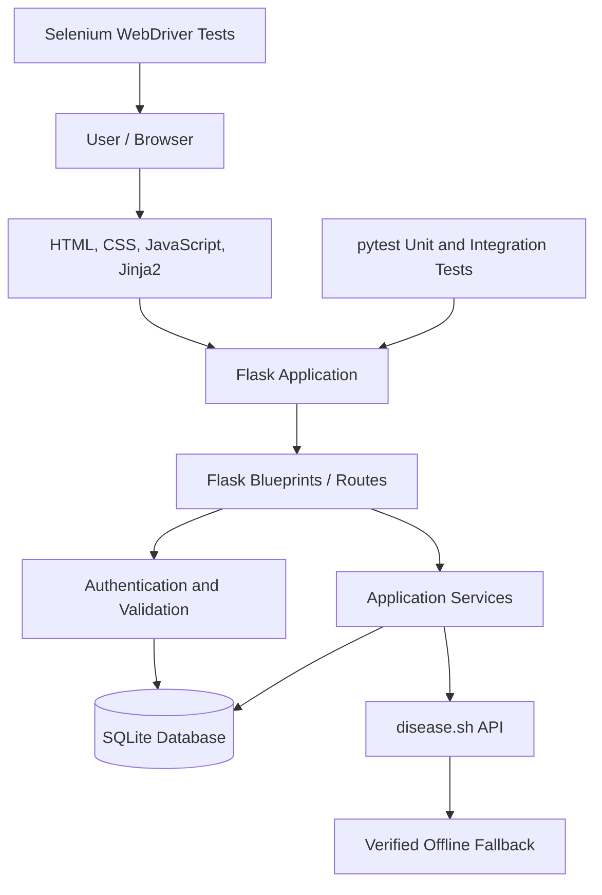
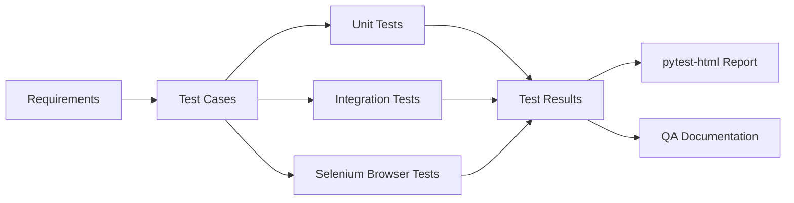

<div align="center">

# 🦠 COVID-FLOW

### COVID-19 Health Intelligence & Testing Portal

*Software Testing and Quality Assurance (STQA) Mini Project*


A responsive COVID-19 information and surveillance portal built with **Python, Flask, SQLite, HTML5, CSS3 and JavaScript**.
It demonstrates practical STQA techniques: centralized input validation, **Equivalence Partitioning (EP)**, **Boundary Value Analysis (BVA)**, unit and integration testing, and **Selenium 4** browser automation using the **Page Object Model (POM)**.

[Overview](#-project-overview) · [Features](#-key-features) · [Quick Start](#-quick-start) · [Testing](#-running-the-automated-tests) · [Docs](#-qa-documentation-and-reports)

</div>

---

## 📑 Table of Contents

1. [Project Overview](#-project-overview)
2. [Key Features](#-key-features)
3. [Technology Stack](#-technology-stack)
4. [Architecture](#-architecture)
5. [Project Structure](#-project-structure)
6. [Quick Start](#-quick-start)
7. [Validation and STQA Techniques](#-validation-and-stqa-techniques)
8. [Running the Automated Tests](#-running-the-automated-tests)
9. [Selenium Browser Automation](#-selenium-browser-automation)
10. [QA Documentation and Reports](#-qa-documentation-and-reports)
11. [Security and Reliability](#-security-and-reliability)
12. [Troubleshooting](#-troubleshooting)
13. [Known Limitations](#-known-limitations)
14. [License and Disclaimer](#-license-and-disclaimer)
15. [Author](#-author)

---

## 📌 Project Overview

COVID-FLOW is a public health information portal developed as an STQA mini project. It pairs a user-facing COVID-19 website with a structured testing environment that demonstrates software quality practices.

| Deliverable | Description |
|---|---|
| **COVID-19 information portal** | Dashboard, global statistics, health guidance, symptom assessment, vaccination information, community discussion, user accounts and programme registration. |
| **STQA testing framework** | Centralized validation, equivalence classes, boundary-value test cases, unit and integration tests, Selenium automation, test reports and examination-oriented documentation. |

The application retrieves statistics from [disease.sh](https://disease.sh) and uses a **verified offline fallback** when live data is unavailable. The interface communicates the data source and synchronization status.

---

## ✨ Key Features

| # | Feature | Details |
|---|---|---|
| 1 | **Live dashboard & global surveillance** | Global confirmed, active, recovered and death counts from disease.sh or the offline fallback. |
| 2 | **Interactive statistics** | 30-day epidemiological trend chart (Chart.js) and a searchable country-wise metrics table. |
| 3 | **Public health guidance** | Prevention protocols, symptom assessment with emergency warning indicators, vaccination facts, myth-vs-fact, and a national/regional helpline directory. |
| 4 | **Authentication & profile** | Registration, password hashing (`werkzeug.security`), sessions, login throttling, and a profile with comment history and registrations. |
| 5 | **Community discussion** | Authenticated comments, 500-character counter, XSS protection, author-only deletion. |
| 6 | **Programme registration** | Webinar and vaccination-alert sign-up with multi-field validation, duplicate prevention and unique references (`COV-2026-XXXXX`). |
| 7 | **Interactive STQA Quality Lab** | Live regex testing across 9 validation categories, boundary-value examples, a 124-case validation runner, and CSV/JSON export. |
| 8 | **Browser test automation** | Selenium 4 + Chrome + Page Object Model against real pages and user workflows. |
| 9 | **Automated reporting** | pytest + pytest-html produce a standalone HTML report. |

---

## 🧰 Technology Stack

| Layer | Technology |
|---|---|
| Language | Python 3.13 |
| Backend | Flask 3.1 (application factory pattern, Blueprints) |
| Database | SQLite 3 with parameterized queries, transactions and foreign keys |
| Frontend | HTML5, CSS3, Vanilla JavaScript (ES6+), Jinja2 |
| Visualization | Chart.js (vendored locally) |
| External data | disease.sh API with offline fallback |
| Browser automation | Selenium 4.52 + Google Chrome (headless supported) |
| Testing | pytest, pytest-html |
| Environment | Python virtual environment (`venv`) |

---

## 🏗️ Architecture

### Application architecture



### Quality assurance architecture



---

## 📂 Project Structure

> Keep actual folder and file names synchronized with this overview.

```text
Covid-flow/
├── app/                          # Flask application package
│   ├── __init__.py               # Application factory
│   ├── routes/                   # Blueprints and route handlers
│   └── ...                       # Models, services, validators, templates
├── scripts/
│   ├── init_db.py                # Database initialization and seed accounts
│   └── run_selenium_tests.sh     # Selenium convenience script
├── tests/
│   ├── unit/                     # Unit tests
│   ├── integration/              # Integration tests
│   └── selenium/                 # Browser automation and page objects
├── docs/
│   ├── SELENIUM_CODE_EXPLANATION.md
│   ├── SELENIUM_VIVA_QUESTIONS.md
│   ├── TEST_PLAN.md
│   ├── TEST_CASES.md
│   ├── TRACEABILITY.md
│   ├── DEFECT_LOG.md
│   └── TEST_REPORT.md
├── reports/
│   └── selenium-report.html      # Generated by pytest-html
├── requirements-dev.txt
├── run.py                        # Application entry point
└── README.md
```

---

## 🚀 Quick Start

### Prerequisites

- Python **3.13** and `pip`
- Google Chrome or Chromium (for Selenium tests)
- Git

### 1. Clone the repository

```bash
git clone https://github.com/Omsongire23/Covid-flow.git
cd Covid-flow
```

### 2. Create and activate a virtual environment

**Ubuntu / Linux / macOS**

```bash
python3 -m venv .venv
source .venv/bin/activate
```

**Windows (PowerShell)**

```powershell
python -m venv .venv
.venv\Scripts\Activate.ps1
```

<details>
<summary>If <code>venv</code> is unavailable on Ubuntu</summary>

```bash
sudo apt update
sudo apt install python3-venv
```

</details>

### 3. Install dependencies

```bash
python -m pip install --upgrade pip
pip install -r requirements-dev.txt
```

Verify key package versions:

```bash
python --version
python -c "import flask, selenium, pytest; print('Flask:', flask.__version__); print('Selenium:', selenium.__version__); print('pytest:', pytest.__version__)"
```

### 4. Initialize the database

```bash
python scripts/init_db.py
```

This seeds two **development-only** accounts:

| Role | Username | Password |
|---|---|---|
| Standard user | `testuser` | `Test@123#` |
| Admin | `admin` | `Admin@123#` |

> ⚠️ **Security notice:** these are local testing credentials. Change or remove them before any public or production deployment.

### 5. Run the application

```bash
python run.py
```

Open **http://127.0.0.1:5000**. Keep the server running while executing Selenium tests.

---

## 🧪 Validation and STQA Techniques

### Validation categories

The Quality Lab covers nine categories: **Username, Full name, Email, Password, Indian mobile number, Date of birth, PIN code, Country search, Community comment.**

The exact rules live in the centralized validator and must be mirrored in the corresponding test cases.

### Equivalence Partitioning (EP)

Input data is divided into classes expected to behave alike; one representative per class is tested to reduce redundant execution.

| Partition | Example | Expected |
|---|---|---|
| Valid username | `om_user12` | ✅ Accept |
| Too short | `om1` | ❌ Reject |
| Contains spaces | `om user` | ❌ Reject |
| Unsupported symbols | `om@user` | ❌ Reject |

### Boundary Value Analysis (BVA)

Tests at, just below, and just above each limit. Example for a **4–20 character** field:

| Input length | Expected |
|---|---|
| 3 | ❌ Reject |
| 4 | ✅ Accept (if other rules pass) |
| 5 | ✅ Accept (if other rules pass) |
| 19 | ✅ Accept (if other rules pass) |
| 20 | ✅ Accept (if other rules pass) |
| 21 | ❌ Reject |

### Regex vs. semantic validation

Regular expressions validate **structure and format**. Semantic validation checks whether a value **makes sense**: a date can match `YYYY-MM-DD` yet still be an impossible calendar date. Application-level checks must complement regex checks.

---

## ▶️ Running the Automated Tests

Run all commands from the project root with the virtual environment active.

| Suite | Command |
|---|---|
| Unit tests | `pytest tests/unit -v` |
| Integration tests | `pytest tests/integration -v` |
| Selenium tests + HTML report | `mkdir -p reports && pytest tests/selenium -v --html=reports/selenium-report.html --self-contained-html` |
| Selenium (convenience script) | `./scripts/run_selenium_tests.sh` |
| Full suite | `pytest tests -v` |

After a run, open `reports/selenium-report.html`. The file is generated by the test command and does not exist until tests have been executed.

### 🔢 Test-count clarification

| Figure | Meaning |
|---|---|
| **67 tests passed** | Reported test battery count (badge snapshot). |
| **124 validation cases** | Quality Lab regex and boundary-case runner. |
| **191 documented test cases** | Full catalogue across unit, integration, Selenium and regex testing. |

These describe **different collections** and must not be added together. Update the badge and report whenever results change, and never claim a test passed unless it was executed successfully.

---

## 🌐 Selenium Browser Automation

The project uses **Selenium 4 WebDriver** with Google Chrome and the **Page Object Model (POM)**.

### Why POM?

POM separates page locators and interactions from test assertions, improving maintainability, reusability and readability.

| Component | Purpose |
|---|---|
| `BasePage` | Parent page object holding the WebDriver, base URL and reusable interaction methods. |
| `By` | Locator strategies: ID, CSS selector, XPath, class name. |
| `WebDriverWait` | Explicit waits for elements and page conditions. |
| `expected_conditions` (EC) | Visibility, presence and clickability conditions. |
| `TimeoutException` | Raised when a condition is not met within the timeout. |

### Imports used by the page objects

```python
from selenium.webdriver.common.by import By
from selenium.webdriver.support.ui import WebDriverWait
from selenium.webdriver.support import expected_conditions as EC
from selenium.common.exceptions import TimeoutException
```

### Verify the Selenium installation

```bash
python -c 'from selenium.webdriver.common.by import By; from selenium.webdriver.support.ui import WebDriverWait; from selenium.webdriver.support import expected_conditions as EC; from selenium.common.exceptions import TimeoutException; print("All Selenium imports working!")'
```

Expected output: `All Selenium imports working!`

> Successful imports verify the **dependency setup only**. They do not prove browser tests pass. Run the suite and inspect the report before recording results.

### Chrome and driver setup

Install Chrome or Chromium. Selenium 4 includes **Selenium Manager**, which discovers or downloads a compatible driver automatically, so manual ChromeDriver installation is generally unnecessary. For headless runs, configure Chrome options in the project's WebDriver setup, and prefer explicit waits over fixed delays.

### Selecting the Python interpreter (VS Code / Antigravity)

1. Press `Ctrl + Shift + P`.
2. Choose **Python: Select Interpreter**.
3. Select the project's `.venv` interpreter (usually `.venv/bin/python`).

If you deliberately use Anaconda instead, select its Python executable and install all dependencies there. Check the active interpreter with:

```bash
which python
python --version
python -m pip show selenium
```

---

## 📚 QA Documentation and Reports

| Document | Description |
|---|---|
| [`docs/SELENIUM_CODE_EXPLANATION.md`](docs/SELENIUM_CODE_EXPLANATION.md) | Walkthrough of page objects, locators, explicit waits and assertions. |
| [`docs/SELENIUM_VIVA_QUESTIONS.md`](docs/SELENIUM_VIVA_QUESTIONS.md) | 32 practical Selenium viva questions with concise answers. |
| [`docs/TEST_PLAN.md`](docs/TEST_PLAN.md) | Formal test plan: scope, tools and objectives. |
| [`docs/TEST_CASES.md`](docs/TEST_CASES.md) | Catalogue of 191 test cases. |
| [`docs/TRACEABILITY.md`](docs/TRACEABILITY.md) | Requirements Traceability Matrix (FR-01 to FR-12). |
| [`docs/DEFECT_LOG.md`](docs/DEFECT_LOG.md) | Defects found, causes and resolutions. |
| [`docs/TEST_REPORT.md`](docs/TEST_REPORT.md) | Execution summary and recorded metrics. |
| [`reports/selenium-report.html`](reports/selenium-report.html) | Standalone pytest-html report (generated). |

Treat the test report as the source of truth for current status, and regenerate it after test changes.

---

## 🔒 Security and Reliability

| Area | Implementation |
|---|---|
| Password storage | Hashing and verification with `werkzeug.security`. |
| SQL injection | Parameterized queries. |
| Database integrity | Transactions and foreign-key constraints. |
| Sessions | Session handling and login throttling. |
| XSS mitigation | Validation and safe rendering of user-submitted content. |
| Duplicate registration | Duplicate prevention in programme registration. |
| External data resilience | Live retrieval with verified offline fallback. |
| User feedback | Clear validation messages and emergency health warnings. |

> Verify security controls against the current implementation and test cases; do not treat a feature as secure merely because it is listed here.

---

## 🛠️ Troubleshooting

| Problem | Fix |
|---|---|
| `ModuleNotFoundError` for Flask/Selenium/pytest | Activate `.venv` and re-run `pip install -r requirements-dev.txt`. Confirm the IDE uses the same interpreter. |
| Selenium tests can't connect | Make sure `python run.py` is running at `http://127.0.0.1:5000`. |
| Chrome / driver not found | Install Chrome or Chromium. Selenium Manager needs network access on first run to resolve the driver. |
| Dashboard shows fallback data | disease.sh may be unreachable or no longer updated; this is expected behaviour. |
| `reports/selenium-report.html` missing | Run the Selenium command in [Running the Automated Tests](#-running-the-automated-tests) first. |

---

## ⚠️ Known Limitations

- Live statistics depend on the availability and response format of disease.sh.
- COVID-19 data may be historical, incomplete or no longer updated upstream; the UI shows source and sync timestamps where available.
- Selenium tests need a supported browser and a running local app.
- Selenium Manager may need network access the first time it resolves a driver.
- Seeded credentials are for local development and examination only.
- The test-count badge is a snapshot and must be updated when the suite changes.

---

## 📄 License and Disclaimer

Developed for **educational demonstration** as part of a Software Testing and Quality Assurance (STQA) mini project. If you reuse this project, retain the relevant data attribution and medical disclaimer.

Medical information is provided for general awareness and attributed to official sources such as the **World Health Organization (WHO)** and the **Ministry of Health and Family Welfare (MoHFW), Government of India**, where applicable.

> **Medical disclaimer:** COVID-FLOW is an academic information and testing project. It is not a diagnostic tool and does not replace professional medical advice, diagnosis or treatment. In an emergency, contact local emergency services or the appropriate official health helpline.

---

## 👤 Author

**Om Songire** · [@Omsongire23](https://github.com/Omsongire23) · [LinkedIn](https://linkedin.com/in/omsongire)

Repository: [github.com/Omsongire23/Covid-flow](https://github.com/Omsongire23/Covid-flow)

<div align="center">

⭐ If this project helped you, consider starring the repository.

</div>
